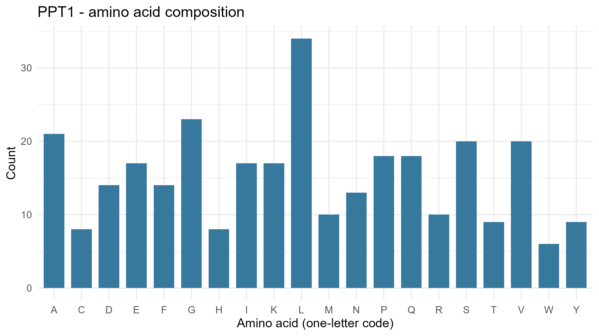
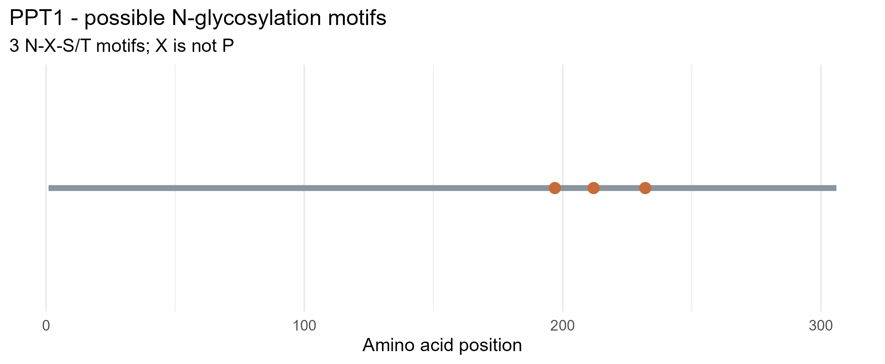

# Exploring Lysosomal Enzymes Using NCBI and R
## Palmitoyl-protein Thioesterase 1 (PPT1)

### 1. Enzyme Information

- **Gene Symbol:** PPT1
- **Enzyme Name:** Palmitoyl-protein thioesterase 1
- **Organism:** Homo sapiens
- **NCBI Protein Accession:** NP_000301.1
- **Protein Length:** 306 amino acids
- **NCBI Protein Record:** https://www.ncbi.nlm.nih.gov/protein/NP_000301.1

### 2. Enzyme Function

PPT1 is a lysosomal enzyme that removes fatty acid groups, particularly palmitate, from proteins. This process helps break down lipid-modified proteins inside lysosomes and supports normal cellular recycling.

### 3. Amino Acid Composition

The PPT1 protein contains 306 amino acids. The five most common amino acids identified using R are:

| Amino Acid | Count | Percentage |
|---|---:|---:|
| Leucine (L) | 34 | 11.11% |
| Glycine (G) | 23 | 7.52% |
| Alanine (A) | 21 | 6.86% |
| Serine (S) | 20 | 6.54% |
| Valine (V) | 20 | 6.54% |

**Figure 1. Amino Acid Composition of PPT1**

### 4. Potential N-Glycosylation Motifs

The R analysis identified three potential N-glycosylation motifs following the N-X-S/T pattern, where X is any amino acid except proline.

| Position | Motif |
|---|---|
| 197 | NHS |
| 212 | NES |
| 232 | NDS |

**Figure 2. Potential N-Glycosylation Motifs of PPT1**

### 5. Laboratory Guide Questions

**1. What does your enzyme normally break down inside lysosomes?**

PPT1 removes palmitate groups from lipid-modified proteins inside lysosomes, helping these proteins undergo degradation and recycling.

**2. What is the total length of your protein, and which amino acids are most common?**

The PPT1 protein contains 306 amino acids. The most common are leucine (34), glycine (23), alanine (21), serine (20), and valine (20).

**3. How many potential N-glycosylation motifs did you find? Where are they located?**

Three potential N-glycosylation motifs were identified at positions 197 (NHS), 212 (NES), and 232 (NDS).

**4. Why can glycosylation matter for lysosomal proteins? Does finding a motif prove the protein is glycosylated?**

Glycosylation can help lysosomal proteins fold properly, remain stable, and reach their correct cellular destination. However, finding an N-X-S/T motif does not prove that glycosylation occurs. The motif only indicates a potential site and does not confirm the presence of a glycan or mannose-6-phosphate tag.

**5. What could happen in the cell if your enzyme did not work properly?**

If PPT1 does not function properly, lipid-modified materials may accumulate inside lysosomes because they cannot be processed normally. This can disrupt cellular recycling and damage cells, particularly neurons. PPT1 deficiency is associated with infantile neuronal ceroid lipofuscinosis, a lysosomal storage disorder.

### 6. Methods

The human PPT1 protein sequence was obtained from NCBI Protein using RefSeq accession NP_000301.1. The provided R script was used to calculate protein length, amino acid counts and percentages, and potential N-glycosylation motifs. The results were saved as CSV files, and two figures were generated using ggplot2.

The analysis identifies potential sequence motifs but does not experimentally confirm protein glycosylation or measure enzyme activity.

### 7. Repository Contents

- `lysosomal_enzyme_analysis.r` — R analysis script
- `data/PPT1.fasta` — Downloaded protein sequence
- `results/PPT1_summary.csv` — Protein summary
- `results/PPT1_amino_acid_counts.csv` — Amino acid composition
- `results/PPT1_motif_positions.csv` — Potential glycosylation motif positions
- `figures/PPT1_amino_acid_composition.png` — Amino acid composition figure
- `figures/PPT1_potential_N_glycosylation.png` — Motif position figure

### 8. Conclusion

The analysis showed that human PPT1 contains 306 amino acids, with leucine being the most abundant. Three potential N-glycosylation motifs were identified. These findings describe important sequence characteristics of PPT1 and demonstrate how NCBI and R can be used to analyze lysosomal proteins.
